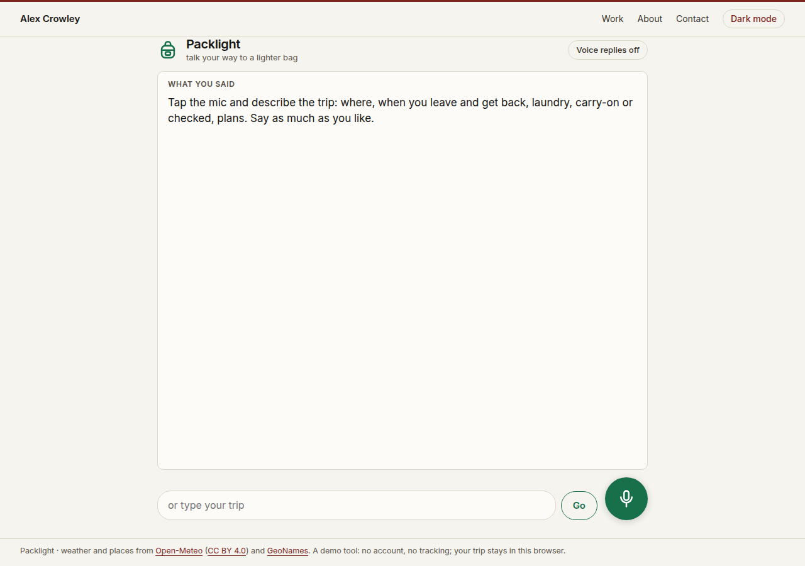
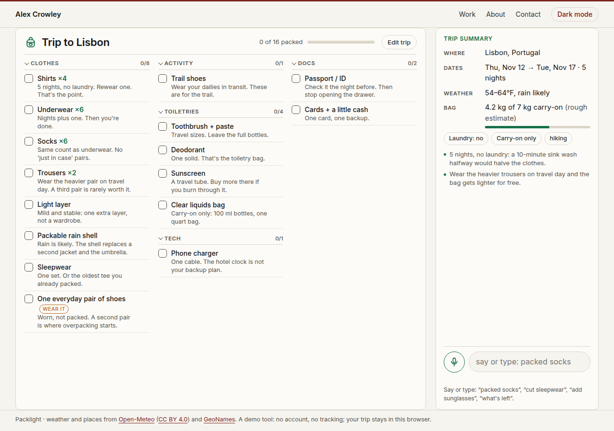

# Packlight

**Talk your way to a lighter bag.** Packlight is a voice-first packing list. Describe a trip — where, when, laundry, carry-on or checked, and what you will do — and it builds a weather-aware checklist that pushes back against overpacking. Check items off by voice or by hand while you pack.

Built by [Alex Crowley](https://alexcrowley.dev).





## Features

- **Two screens.** Describe the trip, then open a checklist titled for that destination.
- **Voice or typing.** One speech session per tap, with the full transcript kept on screen. Typing does the same work.
- **Place lookup.** A spoken place is matched by name, with a country or state qualifier and population as the tie-break, then labeled (for example “Lisbon, Portugal”).
- **Weather-aware lists.** The Open-Meteo forecast covers the next 16 days. Further out, the list uses last year’s weather for those dates. Laundry access and trip length set clothing quantities. Some heavy pieces are tagged “wear it” and stay out of the bag weight.
- **Bag budget.** A rough weight against 7 kg for carry-on or 15 kg for a checked bag.
- **Checklist commands.** “packed socks”, “cut sleepwear”, “add sunglasses”, “what’s left”, “new trip”.
- **Installable static PWA.** No build step and no account. The trip stays in this browser.

## Run locally

Voice input needs a secure context (localhost or HTTPS). From the repo root:

```bash
python3 -m http.server 8000
```

Open http://localhost:8000. The app is served from `/`, the same way it is meant to run at the root of its own domain.

## Privacy

The trip, checklist, voice-reply setting, and theme are stored in `localStorage` on the device (`packlight-web-v1`, `packlight-muted`, `packlight-theme`). Packlight has no account and no backend of its own.

These requests leave the device:

- **The place name** goes to [Open-Meteo’s geocoding API](https://open-meteo.com/en/docs/geocoding-api), which uses GeoNames data under [CC BY 4.0](https://creativecommons.org/licenses/by/4.0/). The page credits both. It does not call geonames.org directly.
- **Coordinates and dates** go to Open-Meteo’s forecast or historical archive API. No API key.
- **Microphone audio**, when you tap the mic, is handled by the browser’s Web Speech API. Packlight never receives the audio. Chrome and Edge send it to the browser vendor’s speech service; Safari depends on the device. Typing does not use the microphone.
- **Spoken replies**, when voice replies are on, use the browser’s speech synthesis.
- **The Inter font** is loaded from Google Fonts, so opening the page contacts Google.

## Deploy

`.github/workflows/deploy-cloudflare-pages.yml` publishes this repo to the Cloudflare Pages project `packlight`. It runs only when started by hand (`workflow_dispatch`). A push does not deploy. The repository needs two secrets: `CLOUDFLARE_API_TOKEN` and `CLOUDFLARE_ACCOUNT_ID`.

## License

[MIT](LICENSE) © Alex Crowley
